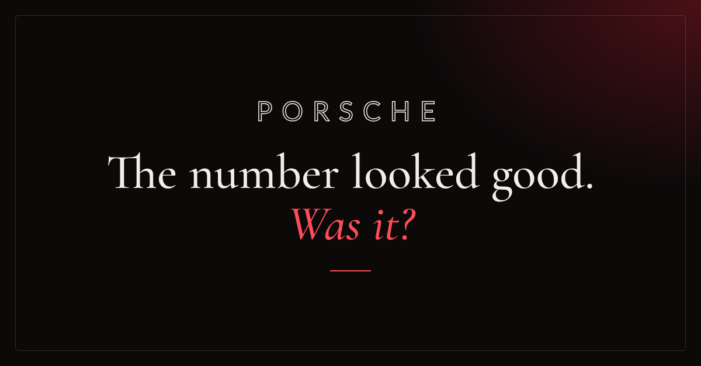
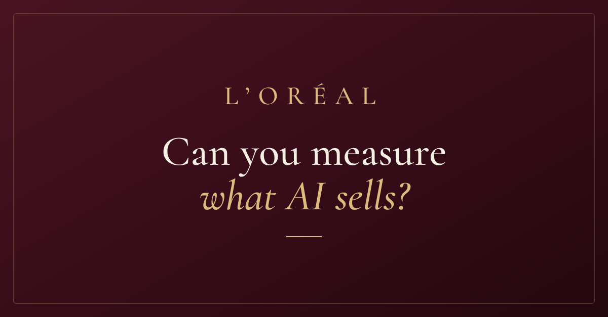
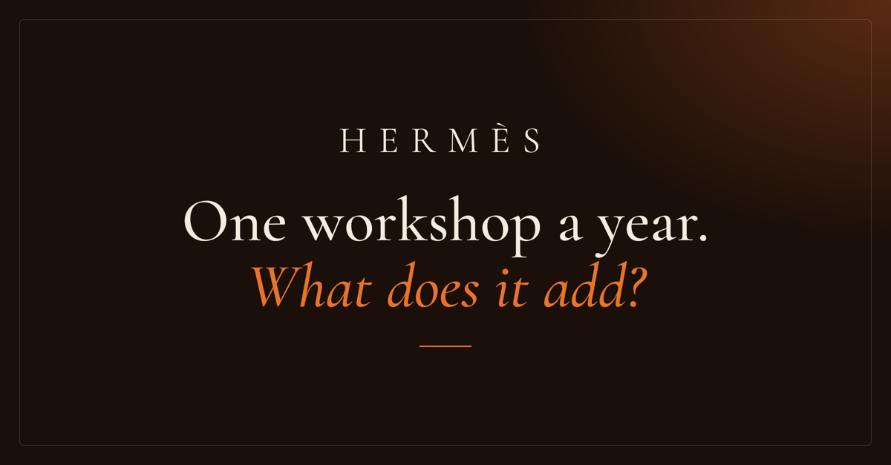

&nbsp;

the plot so far: 4+ years in healthcare and benefits operations. claims, reconciliations, and systems that absolutely refused to talk to each other. somewhere in there i got a bit obsessed with *why* things kept breaking. turns out that's basically analytics.

so now i'm in paris doing an MSc in data analytics for business at KEDGE, working out what the numbers are actually saying (vs what they look like they're saying).

this is where the work lives. the [website](https://vigneshwari2408.github.io/vigneshwari-portfolio/) is where the rest of me lives ♡

&nbsp;

### things i've investigated

<table>
<tr>
<td width="33%" valign="top">

 <b>case 01 · porsche</b> 
the headline said recovery. i rebuilt the H1 2026 margin from 27 of porsche's own documents to see what was underneath. 
PostgreSQL · Excel · Power BI · Python 
<a href="https://vigneshwari2408.github.io/porsche-margin-recovery/">read the case</a> · <a href="https://github.com/vigneshwari2408/porsche-margin-recovery">repo</a>
</td>
<td width="33%" valign="top">

 <b>case 02 · l'oréal</b> 
a purchase tagged "AI-referred" only proves a signal fired. so how would you know what AI discovery actually delivers? 
Excel · company reports · Eurostat · FRED 
<a href="https://vigneshwari2408.github.io/loreal-ai-discovery-measurement/">read the case</a> · <a href="https://github.com/vigneshwari2408/loreal-ai-discovery-measurement">repo</a>
</td>
<td width="33%" valign="top">

 <b>case 03 · hermès</b> 
hermès opens roughly one leather workshop a year. how much artisan capacity does that really add by 2030? 
Excel · Python · JavaScript 
<a href="https://vigneshwari2408.github.io/art-of-scaling-hermes/">read the case</a> · <a href="https://github.com/vigneshwari2408/art-of-scaling-hermes">repo</a>
</td>
</tr>
</table>

&nbsp;

### older things i've built

- **[healthcare claims dashboard](https://github.com/vigneshwari2408/healthcare-claims-analytics-dashboard)** · claim volumes, denial rates and root causes, so at-risk claims get caught early · SQL · Power BI
- **[HR operations dashboard](https://github.com/vigneshwari2408/hr-support-desk-analytics)** · 2,330 support tickets: SLA compliance, resolution time and where requests get stuck · SQL · Python · Tableau
- **[project performance dashboard](https://github.com/vigneshwari2408/project-portfolio-performance-dashboard)** · budget, milestones and burn rate for 1,000 projects, with RAG status · SQL · Power BI

&nbsp;

### currently figuring out

**my MSc thesis:** when netflix adapts a book, does it actually shift demand for the novel, or was the book already on its way up? &nbsp;·&nbsp; [follow along](https://github.com/vigneshwari2408/netflix-thesis-analysis)

<b>class projects from the MSc</b>

 

[china import engine](https://github.com/vigneshwari2408/china-import-engine) · [BNP Paribas persona simulator](https://github.com/vigneshwari2408/bnp-paribas-persona-simulator) · [L'Oréal skin-condition NLP](https://github.com/vigneshwari2408/loreal-skin-condition-nlp) · [La Roche-Posay sales forecasting](https://github.com/vigneshwari2408/la-roche-posay-sales-forecasting)

&nbsp;

### what work taught me

before the MSc: benefits operations at TriNet Zenefits, claims at Optum and Legato, a stint in financial operations at Northern Trust. different companies, same habit. i kept getting more curious about *why* something broke than about fixing it twice.

&nbsp;

<b>come say hi</b> 
<a href="https://vigneshwari2408.github.io/vigneshwari-portfolio/">website</a> &nbsp;·&nbsp; <a href="https://www.linkedin.com/in/vigna24">linkedin</a> &nbsp;·&nbsp; <a href="mailto:vigna2408@gmail.com">email</a> 
open to business, operations & business analysis roles in france and the EU

